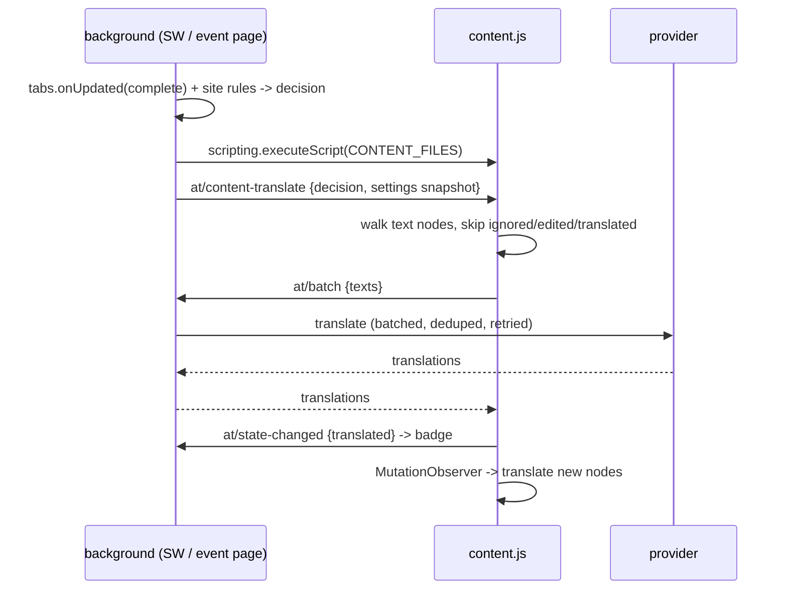

# Autotranslate

Automatic web-page translation for **Chrome** and **Firefox** from a single Manifest V3
source tree. One `src/` folder, one build script, two browser-specific bundles.

Pages are translated in place: text nodes are replaced, originals are kept so the page can
be restored, and a `MutationObserver` keeps up with dynamically inserted content. Translation
requests are issued by the background context, so provider endpoints and API keys never reach
content scripts.

## Requirements

| Browser | Minimum | Why |
| --- | --- | --- |
| Chrome | 121 | MV3 + the `background.scripts` fallback key must be ignored, not rejected |
| Firefox | 121 | MV3 `scripting` API and `background.scripts` alongside `service_worker` |

## Quick start

```sh
npm install          # vendors webextension-polyfill
npm run build        # -> build/chrome, build/firefox
```

**Chrome** — open `chrome://extensions`, enable *Developer mode*, *Load unpacked*,
pick `build/chrome`.

**Firefox** — open `about:debugging#/runtime/this-firefox`, *Load Temporary Add-on…*,
pick `build/firefox/manifest.json`. Unsigned add-ons can only be loaded temporarily;
`web-ext sign` (not bundled) is needed for a permanent install.

Both bundles are plain unpacked extensions: no bundler, no transpiler, no runtime
dependencies in the shipped files.

## Scripts

| Command | Effect |
| --- | --- |
| `npm run build` | validate `src/`, then emit `build/chrome` and `build/firefox` |
| `npm run build:chrome` / `build:firefox` | one target only |
| `npm run watch` | rebuild on any change under `src/` |
| `npm run lint` | run the validator without writing output |
| `npm test` | `node --test test/*.test.mjs` |
| `npm run icons` | regenerate `src/icons/*.png` from `scripts/make-icons.mjs` |

The build is also the linter: it fails on a manifest/package version mismatch, a
missing referenced file, a JS syntax error, a PNG that is not a PNG, a missing
`_locales` key in either locale, or a `background.scripts` list that no longer
matches the `importScripts()` call in `background.js`.

## Layout

```
src/
  manifest.json      single source; the build rewrites it per target
  background.js      menus, badge, tab state, message router, auto-translate
  content.js         injected on demand: translate / restore / selection card
  popup.{html,js}    per-tab controls
  options.{html,js}  provider, language, limits, site rules
  styles.css         shared by popup and options
  lib/
    constants.js     AT namespace, message names, languages, provider catalogue
    browser.js       API handle, i18n helpers, promise-safe onMessage wrapper
    rules.js         site pattern matching and precedence
    settings.js      defaults, validation, persistence, content snapshot
    engines.js       Google + LibreTranslate providers, retries, batching
    dom.js           text-node walker, replacement cache, restore
  _locales/{en,ko}/messages.json
  icons/             generated PNGs (16/32/48/128)
scripts/
  build.mjs          per-target manifest + vendor copy + validation + watch
  make-icons.mjs     dependency-free PNG encoder
test/                node:test suites (rules, engines, settings, build)
```

Every `lib/*.js` file is a classic script that attaches to a global `AT` namespace,
because the two background contexts load code differently (see below). Load order is
fixed: `constants → browser → rules → settings → engines → dom`.

## How a page gets translated



Decisions live in the background (`decide()` in `background.js`); the content script only
compares the declared page language with the target language when asked to `detect`.
Content scripts are never declared in the manifest — they are injected on demand, so
untouched pages pay nothing.

## Cross-browser handling

| Difference | Chrome | Firefox | How `src/` copes |
| --- | --- | --- | --- |
| Background context | `background.service_worker` | `background.scripts` (event page) | both keys in one manifest; MDN's sanctioned fallback pattern |
| Loading shared code | `importScripts()` in the worker | ordered `scripts` array | `background.js` calls `importScripts` only when it exists; the build asserts the two lists match |
| Promise APIs | native | varies by API | vendored `webextension-polyfill` is loaded first in every context |
| Add-on identity | none | `browser_specific_settings.gecko.id` | injected by `scripts/build.mjs` for `--target=firefox` |
| Chrome-only keys | `minimum_chrome_version` | would be dead weight | stripped for the Firefox bundle |
| Unsigned packages | fine | temporary load only | documented above; sign with `web-ext` when publishing |

## Providers

| Provider | Endpoint default | Notes |
| --- | --- | --- |
| `google` | `https://translate.googleapis.com/translate_a/single` | keyless **unofficial** endpoint: rate limits and payload shape can change without notice. Texts are joined with newlines per request and split back; if the split cannot be reproduced, that chunk is re-run one text per request instead of guessing. |
| `libretranslate` | `http://127.0.0.1:5000/translate` | stock LibreTranslate on your machine; any instance that answers `POST /translate` with `{q: [...]} -> [{translatedText}]` works. Optional `api_key`. |

Rules that apply to both: endpoints must be `https` (plain `http` only for
`127.0.0.1`/`localhost`), requests are chunked under the provider's character budget,
identical strings are sent once, whitespace/number-free nodes are never sent, empty or
missing translations keep the original text, and `429`/`5xx`/network failures are retried
once. Failures surface in the popup with a code (`http`, `rate-limit`, `timeout`,
`network`, `format`, `config`) instead of silently leaving a half-translated page.

Provider traffic is deliberately *not* exercised against live endpoints in CI: the
suites stub `fetch` with recorded response shapes (including HTML rate-limit pages,
`{error: ...}` bodies and short replies). Run the "Test provider" button in
`Options → Provider` to check a real endpoint.

## Site rules

Patterns accept `example.com`, `*.example.com`, `example.com/news/*` and
`https://example.com/news/*`. They are canonicalised on save (case, leading `www.`,
leading `*.` folded away) and compared by specificity: explicit scheme > host labels >
path prefix length. A tie resolves to `never`, so `example.com → always` plus
`news.example.com → never` does the obvious thing.

## Limits

- Top frame only; iframe content is left alone.
- No Shadow DOM traversal, no `<canvas>`/image or subtitle translation.
- `pre`, `code`, `textarea`, `select`, `abbr`, `[translate="no"]`, `.notranslate` and
  `contenteditable` regions are never rewritten.
- Per page: at most `maxNodes` text nodes (default 600) and `batchChars` characters per
  request (default 1200, capped by the provider).
