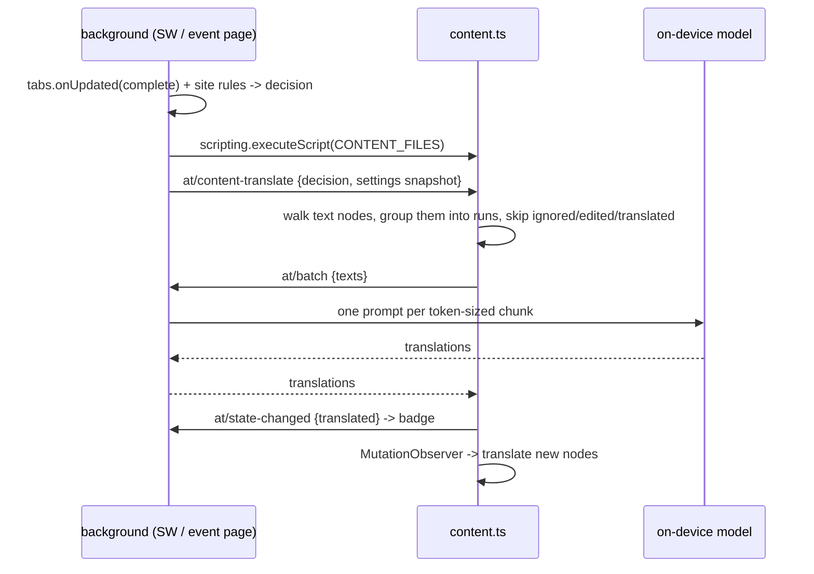

# Autotranslate

A Manifest V3 TypeScript extension that translates explicitly selected browser
 tabs in place and restores their latest original text. The translation engine
can be either **on-device PLaMo 3** or an **OpenAI-compatible server**.

Pages are translated in place: text nodes are replaced, originals are kept so the page can
be restored, and a `MutationObserver` keeps up with dynamically inserted content. Translation
is **on-device only**: PFN's PLaMo 3 Translate 0.8B runs in the browser, driven by the
extension's own host document, so no page text ever leaves the browser and there is no endpoint,
no API key and no account to set up (see [On-device translation](#on-device-translation)). The
picker offers English, Korean and Japanese — the languages that model was published with
benchmark numbers for. One runtime ships: the ONNX export, run by Transformers.js over WebGPU.
Chrome is the supported packaged target. Firefox builds are available for
experimentation, but the on-device path has never been run end to end there — no
Firefox archive is published. Adding the server
adapter is not a claim that all Firefox paths have been validated.

## Use an existing compatible server

| Requirement | Minimum | Why |
| --- | --- | --- |
| Chrome | 121 | MV3 + the `background.scripts` fallback key must be ignored, not rejected |
| Firefox | 121 | MV3 `scripting` API and `background.scripts` alongside `service_worker` |
| Node | 24 | runs `tsc` and executes the `test/*.ts` suites directly (type stripping) |
| WebGPU with `shader-f16` | — | required, not optional: the model's weights and activations are fp16, and the host probes the adapter for the feature before it loads a graph |
Open the extension popup on the page to translate, then **Options**. Options opens
in that tab's side panel when supported, otherwise in a separate popup window.
Select **OpenAI-compatible server**, set **Base URL**, optional **API key**, and
**model ID**, then **Save**. Use **Load models** for suggestions or enter the ID
manually. **Test provider** tests the currently displayed fields before saving.

Example settings for a server exposing model `big`:

```text
Engine:    OpenAI-compatible server
Base URL:  http://localhost:8000/v1
API key:   optional; leave empty for an unauthenticated local server
Model ID:  big
```

Replace localhost with the actual server hostname when it runs on another
machine. Root URLs get `/v1` appended; explicit reverse-proxy paths are preserved.
The server must support `POST /chat/completions`. `GET /models` is optional.

**Server mode requires no local model download, local tokenizer or WebGPU.** On a
fresh install, choose **Configure compatible server** in onboarding instead of
installing the on-device model. The original local engine remains available.
See [the server guide](docs/compatible-server.md) for protocol, errors and privacy.

## Explicit per-tab control

Every tab starts **OFF**. Turn **Translate this tab** ON only for the intended
tab. Other tabs, including other pages of the same site, stay unchanged. OFF
cancels that tab's outstanding server requests and restores its latest original
text. New DOM content, text-node reuse and same-tab navigation are processed
while that tab remains selected. Closing a tab discards its selection; browser
session storage preserves selection across service-worker suspension only.

Options retains the originating tab even when another tab gains focus. Closed
or unbound target tabs cannot silently be replaced with another translation
target. Setup and provider tests never opt a web tab in.

## Privacy and network behavior

On-device mode runs the published ONNX export of PLaMo 3 Translate 0.8B through the
bundled Transformers.js/onnxruntime-web runtime; the graph and its tokenizer are
downloaded once or imported from disk. In that mode, page translation text does not
leave the browser.

Server mode sends the selected tab's text and bounded page/region context to the
configured server. An explicit provider test sends a fixed sample sentence.
API keys remain in browser-local extension storage, not sync or page messages;
this is **not encrypted secret storage**. Supported browsers restrict that
storage to trusted extension contexts. Plain HTTP is unencrypted; use HTTPS
outside trusted local networks. Requests omit cookies/referrers and refuse
redirects. There is no silent provider fallback or automatic paid-request retry.

## Build and install

Node **24+** is required for the existing TypeScript test tooling.

```sh
npm install          # typescript, @types/node, webextension-polyfill, @huggingface/transformers
npm run build        # compile + validate -> build/chrome, build/firefox, dist/*.zip
```

The build compiles `src/` and `demo/` with `tsc`, validates the result, copies the
per-target assets, and packs each bundle:

```
build/chrome/                          load unpacked from here
build/firefox/                         load temporarily from here
dist/autotranslate-<version>-chrome.zip    upload as is
dist/autotranslate-<version>-firefox.zip   upload as is (AMO accepts .zip; rename to .xpi if you prefer)
```

**Chrome** — open `chrome://extensions`, enable *Developer mode*, *Load unpacked*,
pick `build/chrome`.

**Firefox** — open `about:debugging#/runtime/this-firefox`, *Load Temporary Add-on…*,
pick `build/firefox/manifest.json`. Unsigned add-ons can only be loaded temporarily;
`web-ext sign` (not bundled) is needed for a permanent install.

Either way the first thing that opens is the onboarding page (see [First run](#first-run)).

Translation waits on one download the user makes once. The file is whatever
`AT.local.defaultSource()` offers — the q4f16 ONNX graph at
`TeamFlaxia/plamo-3-translate-0.8b-onnx`, 705,701,446 bytes, with its tokenizer and
config fetched beside it (see [Getting the model](#getting-the-model)). A url typed into
Options is installable too, and only the runtime's own verdict decides whether it loads.
The bytes live as a plain file in the origin's private file system and only the record describing
them goes to IndexedDB, so they are fetched once and never again — and that transfer is the only
thing in the extension that touches the network.

The shipped files are plain classic scripts: `tsc` compiles and type-checks, there is no
bundler, no polyfill beyond the vendored `webextension-polyfill`, and no runtime
dependency ends up in the package.

## First run

Translation is off and there is no model until the user finishes onboarding, which is the
only thing a fresh install shows:

| Step | What happens | Where |
| --- | --- | --- |
| 1 | Choose the language pages are translated into — en, ko or ja, defaulting to the browser's UI language when that is one of them, otherwise English | `welcome.html` |
| 2 | Install the model: **download** the card's file (its declared byte count, progress, cancel) or **pick a file** already on disk. Either route writes it into OPFS, then asks the host to load it — a file that does not load is not "installed" | `welcome.html` → `AT.modelflow` |
| 3 | Press *Start translating*: `enabled: true`, the model id and the language are stored, and the page closes | `welcome.html` |

`runtime.onInstalled` (reason `install`) opens this page and stores `enabled: false`. If the
profile already holds a working model (a reinstall, a second browser), the page says so and
only asks for the language and the *Start* click.

Before it offers anything, the page asks the host whether this browser can run a model at
all. When the WebGPU probe fails, the download button is disabled and the page says the
browser cannot run the model, so nobody spends a gigabyte-class download on a file that will not
load.

**Side panel first.** `AT.ui.openPage` docks the page to the side of the window when the
browser has `chrome.sidePanel` (`side_panel.default_path` is `welcome.html`), and opens a tab
when it does not. Chrome only allows `sidePanel.open` in response to a user gesture, and an
install is not one, so the first run after installing still lands in a tab; the popup's
settings button *is* a gesture, so on a profile without a model it reopens onboarding in the
panel. Firefox has no side panel: it always gets the tab.

After that there is one control: the popup's switch. On translates every page into the target
language and applies at once to the tab in front of the user; off puts the page back and stops
translating new ones. A per-site rule (`never`/`always`, set in Options or from the page's
context menu) is the only exception. The popup also carries the target language; everything
else lives in Options, which stays an ordinary settings page rather than part of the flow.

## Scripts

| Command | Effect |
| --- | --- |
| `npm run build` | compile, validate `src/`, emit `build/{chrome,firefox}` and `dist/*.zip` |
| `npm run build:chrome` / `build:firefox` | one target only |
| `npm run watch` | rebuild on any change under `src/` |
| `npm run typecheck` | `tsc --noEmit` over the extension and over the tooling/tests |
| `npm run lint` | run the validator without writing output |
| `npm run verify` | audit `dist/*.zip`: CRC per entry, entry list against `build/<target>`, manifest flavour |
| `npm test` | compile, then `node --test test/*.test.ts` |
| `npm run ci` | typecheck, lint, test, build, verify — the exact steps CI runs |
| `npm run demo` | serve the sample page at `http://127.0.0.1:8732/demo/` |
| `npm run icons` | regenerate `src/icons/*.png` from `scripts/make-icons.ts` |
| `npm run onnx:vendor` | regenerate `vendor-src/onnxruntime/` (the classic-script ONNX runtime the build copies) from the installed `@huggingface/transformers` + `onnxruntime-web` |
| `npm run model:bundle` | fill `weights/` with the published q4f16 graph and its parts, so the next build ships them inside the package (`--from <dir>` copies files already downloaded) |

The build is also the linter: it fails on a manifest/package version mismatch, a
missing referenced file, a TypeScript error in `src/`, `demo/`, `scripts/` or `test/`, a
PNG that is not a PNG, a missing `_locales` key in either locale, or a `background.scripts`
list that no longer matches the `importScripts()` call in `background.ts`.

## Layout

```
src/                     TypeScript, compiled to classic scripts (no bundler)
  manifest.json          single source; the build rewrites it per target
  background.ts          menus, badge, tab state, message router, auto-translate
  content.ts             injected on demand: translate / restore / selection card
  welcome.{html,ts}      first run: language, model install, switch on
  popup.{html,ts}        the on/off switch and the target language
  options.{html,ts}      model store, limits, site rules, debug
  styles.css             shared by welcome, popup and options
  offscreen.html         the Chrome placement of the on-device host, opened by URL
  offscreen.ts           message plumbing for that document; the host itself is a lib
  lib/
    constants.ts         AT namespace, message names, languages
    browser.ts           the only file that names the host global; AT.api, capabilities, i18n, onMessage
    local.ts             prompts, token budgets, model records, host status, storage keys
    modelstore.ts        model bytes in OPFS + metadata in IndexedDB (seams for tests)
    modelflow.ts         one install path (download or file) + prepare, shared by welcome and options
    ui.ts                where an extension page is shown: side panel when the browser has one, else a tab
    plamo3.ts            PLaMo's language table, the PFML3 prompt, the script guard
    pagecontext.ts       what kind of page this is, from its own metadata (collect / analyze / hint)
    targets.ts           which region a text is in, how visible it is, and what to translate first
    pipeline.ts          the page translation engine: page context + plan + batches + write-back
    onnxhost.ts          the on-device host: Transformers.js/WebGPU, OPFS-served model files, one queue
    rules.ts             site pattern matching and precedence
    settings.ts          defaults, validation, persistence, content snapshot
    engines.ts           the model call: chunking, language refusal, error codes
    dom.ts               text-node walker, run merging, replacement cache, restore
  _locales/{en,ko}/messages.json
  icons/                 generated PNGs (16/32/48/128)
demo/                    offline sample page that drives the same AT.dom engine
  index.html             sample document + request inspector
  demo.ts                translates, restores, and verifies the sample
  demo.css               the sample's own styling
  glossary.ts            offline phrase dictionary (a stub, not a model)
scripts/
  build.ts               compile + per-target manifest + vendor copy + validation + zip
  zip.ts                 dependency-free ZIP writer/reader
  package-spec.ts        targets, required entries per target, add-on id, archive name
  verify-package.ts      packaging gate: audits the archives in dist/
  make-icons.ts          dependency-free PNG encoder
  serve-demo.ts          static server for the sample page
test/                    node:test suites in TypeScript, one file per feature:
  rules, settings, constants     site rules, settings normalisation, the shared catalogue
  engines                        the model call: chunking, language refusal, error codes
  dom, content                   walker, run merging, restore, selection card, observer
  targets, pagecontext, pipeline region and visibility plan, page metadata, the pass itself
  background, popup, options     message router and tab state, the two UI pages
  welcome, ui                    the onboarding flow, side panel versus tab
  i18n, messages                 catalogue substitutions, data-i18n apply, send/receive envelope
  glossary                       the offline sample dictionary
  local, plamo3, modelstore    prompts, chunking, records, status; the PFML3 prompt; transfers and cleanup
  build, zip, fresh-clone        validator, archive format, a build from a clean checkout
build/                   generated: build/ts (tsc output), build/{chrome,firefox}
dist/                    generated: one zip per target
```

Every source file compiles to a **classic script** that attaches to a single global `AT`
namespace (`tsconfig.json` sets `module: "none"`), because the two background contexts load
code differently and MV3 content scripts cannot be ES modules. Types live in the file that
owns the value, so `AT.settings.Settings` or `AT.dom.Translator` is the contract consumers
compile against. Load order is fixed, and the background's `scripts` list in `manifest.json`
is the authoritative copy of it: `constants → browser → plamo3 → pagecontext → targets → rules
→ local → modelstore → ui → settings → engines → onnxhost → background`.

## How a page gets translated



Decisions live in the background (`decide()` in `background.ts`): the switch and the per-site
rule are the whole policy, and the content script never reads settings, never reads site rules
and never judges for itself whether a page is already in the target language. The detector's
answer is reported to the popup and used for nothing else, so no page is silently skipped
manifest — they are injected on demand, so untouched pages pay nothing. Injection is event-driven, so
`resyncOpenTabs()` also runs on `runtime.onStartup` and `runtime.onInstalled`: the pages a browser
start restores, and every tab an update drops its content script from, finished loading while no
worker existed to hear their `complete` event, and would stay in the source language until reloaded.

### Keeping the page intact

`AT.dom.createTranslator` writes **only `Text.nodeValue`**. It never creates, removes,
re-parents or re-attributes an element, so the CSS cascade, classes, inline styles, event
listeners, focus, and every layout box are exactly what the page authored. Originals are
kept in a `Map<Text, {source, text, applied}>` in memory — never as DOM attributes — which
is what makes byte-exact `restore()` and "did the page rewrite this node since we touched
it" both possible.

Around that, three rules decide what leaves the page and where the answer lands:

- **Whitespace envelope.** Leading/trailing whitespace is split off before the request and
  re-attached afterwards, so a model that trims its answer cannot swallow the only space
  between two inline elements, and authored indentation survives.
- **Inline runs are merged.** Consecutive text nodes that a reader sees as one sentence —
  split by `<strong>`, `<a>`, `<em>` — are sent as **one** string, so the model can re-order
  the sentence the way the target language needs. A run never crosses a block element or a
  `<br>`, and an ignored inline element (`<code>`, `pre`, …) drops out of the sentence without
  breaking it. Set `mergeInline: false` to send every text node separately.
- **The answer is divided by share, not by placeholders.** Nothing in the text asks the model
  to echo any structure back: a merged run comes back as one sentence and is then split over
  the nodes it came from by each node's share of the source, cut at word boundaries
  (`AT.dom.distributeRun`). An answer that reorders or rewrites the sentence can therefore
  shift a phrase between two inline elements, but it can never strand one in the wrong
  element or lose a generation to a token the model swallowed.

Ignored content is decided by `C.IGNORE_SELECTOR` plus `isIgnoredElement` (contenteditable
regions and their editable children), and `hasText` keeps whitespace, punctuation and symbol
only nodes out of the request entirely.

### Reading the page, not guessing it

A page publishes what it is, in three layers, and `lib/pagecontext.ts` reads all
three without leaving the page:

| Layer | Where | What it yields |
| --- | --- | --- |
| Structured data | `meta[property="og:*"]`, `meta[property="article:*"]`, schema.org `JSON-LD` (parsed, `@graph` included), microdata | page kind, site name, section, tags, **entities** (people, places, organisations, works, `DefinedTerm`s), the page's declared subject (`about` / `mentions`) |
| Semantic HTML | `nav`, landmarks, `dl`/`dt`/`dd`, `dfn[title]`, `abbr[title]` | the site's **sections** (its own navigation labels) and a **glossary** of terms the page defines |
| Accessibility | `html[lang]` and per-element `lang` | the page's language, and which regions are already in it |

`collect` is the only half that touches the DOM; `analyze` is pure and decides what the
values mean. The markup's claim outranks the URL — `og:type: product` is a product page
whatever the path says — and the vocabulary is deliberately conservative: a page that
claims `og:type: article` stays an *article* even when it has a category, because calling a
blog post "news" would put a wrong register in the prompt. A page whose metadata says
nothing useful ends up `unknown`.

Every axis is bounded, because all of it is attacker-controlled markup: 8 JSON-LD scripts of
120 KB, a 400-node graph walk at depth 6, 12 entities, 8 sections, 12 glossary terms, 200-char
texts. A JSON-LD script that does not parse is still scanned for `"@type"` names, so a
truncated payload still tells us what kind of page it is.

Where it goes: the content script collects once per translation pass and sends the result
with each `at/batch`; the background normalises it (nothing from a page is trusted) and the
on-device engine renders **one line** of it into the prompt as a `context` element. The whole
request is one PFML3 document in the element order the card publishes
(`dataset → context → history → glossary → input → output`). The shipped host does not spell that
document out: it calls the tokenizer's `apply_chat_template` with the text and the target code, and
`chat_template.jinja` from the model directory writes it:

```
<|plamo:tag|>dataset<|plamo:msg|>translation<|plamo:tag|>context<|plamo:msg|>This is a news article in the Politics section from Example News. It mentions Alice Smith, The Coalition and Bob Jones.<|plamo:tag|>input<|plamo:msg|>The headline<|plamo:tag|>output<|plamo:key|>lang<|plamo:val|>ko<|plamo:msg|>
```

`AT.plamo3.buildPrompt` and `AT.local.buildEnginePrompt` / `buildEngineBatch` are the same
document written in TypeScript, which is what the token-budget tests measure against without a
tokenizer. Nothing is asked in prose: the element names are the instruction, which is why page text
is scrubbed of `<|plamo:` markers on the way in (`AT.plamo3.sanitize`) — text carrying one could
close the element and write the rest of the request. Several texts go out as one numbered `input`
element instead (`AT.onnxhost.translateChunk`), and the reply is split back by segment number
(`AT.local.parseNumbered`) — a reply whose numbers cannot be trusted is redone one text at a time
rather than mapped onto the wrong nodes.

Measured against real markup (the HTML five sites actually served, parsed the way a page is):

| Page | kind | site | sections | glossary |
| --- | --- | --- | --- | --- |
| ikea.com product (og `product.group`, 24 `Product` nodes in an `ItemList`) | `product` | IKEA | Products, Rooms, Deals, Design & ideas | 0 |
| meta.discourse.org topic (no JSON-LD, `generator: Discourse …`) | `forum` | Discourse Meta | Home, Categories, Guidelines | 0 |
| developer.mozilla.org reference | `docs` | MDN Web Docs | the page's own nav | 3 |
| en.wikipedia.org article (MediaWiki JSON-LD: `Article`, `Organization`) | `article` | en.wikipedia.org | footer links (the header has none) | 12 |
| github.com repository (`og:type: object`, nothing else) | `unknown` | GitHub | Actions, Documentation, Training | 0 |

The catalogue in the IKEA page and the publisher in the Wikipedia page are exactly the noise a
graph is full of, so entities are not "everything named": only `about`/`mentions` (the
declared subject), people, defined terms and events are kept. That table is also why the rules
look the way they do — `og:type: product.group` counts as a product, a platform generator can
be the only claim a forum makes, and `og:type: object` with no structured data earns nothing.

Only a recognised kind earns the first sentence, and only named entities earn the second;
an unidentified page with nothing named adds no line at all, because a bare host is true of
every page and would cost prompt tokens. The glossary is *not* in that line: it is collected
for consistency work (the same term translated the same way), not for describing the page.
Nothing is fetched to build any of this — the module only reads markup the page already
downloaded.

### The page translation engine

`lib/pipeline.ts` is where the modules meet. It owns one pass end to end:

```
pagecontext.collect/analyze  →  PageContext (site, section, subjects)
dom.collect                  →  the page's text nodes
targets.roleOf / priorityOf  →  per node: region and visibility
targets.plan                 →  ordered groups (visible first, one per region)
dom.translateNodes           →  batches, sentence-split, written back in place
```

The only thing it asks of the outside world is `translate({ texts, role, context })`, so the
same engine drives the browser (the callback posts `at/batch`) and the tests (the callback
returns strings). `translate()` is a fresh pass; `refresh()` is the scroll/mutation pass and
only pays for text that is not done yet; `restore()` puts the page back and drops the records.
`content.ts` is now a thin adapter: message handling, the observer and scroll timers, the
selection card — no planning and no DOM classification of its own.

### What gets translated, and in what order

The page is a document, not a bag of strings: a comment under an article, a menu label and a
table cell want different treatment, and a reader sees one screen of it at a time.
`lib/targets.ts` answers three questions mechanically (no model, no network):

| Question | Rule |
| --- | --- |
| Which region is this text in? | `comment` > `navigation` > `form` > `footer` > `aside` > `heading` > `article` > `list` > `metadata`, decided from tags (`article`, `main`, `nav`, `form`, `footer`, `aside`, `h1`–`h6`, `ul`/`li`, `time`), ARIA roles, `itemtype="…Comment"`, and the class/id names sites actually use for comment threads |
| Is it on screen? | `getBoundingClientRect()` against the viewport: `visible`, then a one-screen ring (`near`), then `far` |
| In what order do we send it? | `visible` first, then `near`, then `far`; inside one priority, grouped by region (headings, article text, lists, metadata, comments, forms, navigation, asides, footer) and kept in document order inside a group |

A comment inside an article stays a comment, a list inside an article stays article text, and
a menu inside a footer stays navigation — precedence is the table above, not the first tag
found. The translator then runs one pass over that plan, so the screen is translated before
the rest of the document, and a scroll pass translates what came into view since (the `done`
set in `pipeline.ts` keeps it from paying for a node twice).

**Pages that render late, and pages that never stop changing.** Four failures decided the
shape of a pass on real sites:

| Failure | What the script does now |
| --- | --- |
| A single-page app reports `complete` with an empty body, so the first pass finds nothing to read | it asks the model for nothing and the observer takes over: an inserted subtree is a region, a region schedules a tick, so text that arrives a second later is translated when it lands |
| A page that mutates faster than the debounce (video progress, ads, live counters) pushed the pending tick back forever | a mutation inside the window keeps the scheduled tick and marks another one due, so the pass runs |
| A page that rewrote a translated node's text in place put the source back, and the node was then skipped because its answer was already cached | the cache answers the write as well as the request: the node is translated again without asking the model |
| Every mutation meant reading the whole body again — thousands of nodes, several times a second, on a feed | the observer reads its own records: an inserted subtree or an edited text node is the region the tick visits. Removals, ignored regions (`contenteditable`, `translate="no"`) and the script's own write-back are dropped before they can schedule anything, and a tick that is already running only leaves a note for the next one instead of starting a second pass |

A batch that fails no longer takes the rest of the page with it: the nodes stay eligible, the
remaining groups still translate, and the pass reports `failed` and the host's own message.
Only a pass where *every* group failed is an error, which is what the popup shows.

Grouping is also what lets a batch carry register: a batch of navigation labels, comments or
form labels gets one extra line in the on-device prompt (`These are navigation labels.`), on
top of the page context. Article prose gets no line — the page context already says what it is.
That line is per batch rather than per text because every line is prompt tokens, and what one
costs this model is not measured yet.

**Sentence splitting.** A multi-sentence text node is split into sentences before it is sent:
each sentence is its own key, the translations are joined back into the same node, and the
separator is the page's own habit — a space when the source used spaces, nothing between CJK
sentences. That is what keeps a long paragraph from being cut mid-clause, and it means one
paragraph can span several prompts without losing its place. `targets.sentences()` uses
`Intl.Segmenter` with a punctuation fallback; it is not abbreviation-aware (`Dr.` splits),
which is pinned in the tests rather than papered over.

**One request per text.** A paragraph's sentences travel in one request: the numbered prompt
holds them in order, so each sentence is translated with the others as its context — that is
the paragraph, and no separate hint line is sent. Requests are not batched across texts: the
DOM layer issues one request per text node or merged run and writes it the moment it is
answered, which is what makes a long page fill in progressively. Per-request versus packed-request
cost on this engine is still unmeasured.

**What context is sent (decided).** One line per batch, composed in this order and capped at
`targets.CONTEXT_MAX_CHARS` = 240 characters — about 45 tokens at the Latin prior of 5.33 characters
per token:

| Order | Content |
| --- | --- |
| 1 | the page line: kind, section, site, and up to three named subjects |
| 2 | the region line, only for regions where register matters (`comments`, `navigation`, `form`, `heading`, `list`, `metadata`, `aside`, `footer`) |

Nothing else goes in. The collected glossary, site sections and entity list stay out of the
prompt on purpose: the glossary exists so the same term is translated the same way, not to
describe the page, and a whole metadata block would spend the budget on surroundings instead of
on the text. Above the cap the line is cut on a word boundary, never grown, and
`AT.targets.composeContext` is the only place that decides it — raising `localMaxTokens`
(128–8192) later changes the budget, not that function.

## Cross-browser handling

Every context calls the extension API through the `browser` abstraction: `src/lib/browser.ts`
is the single file that names a host global (standard `browser` from the vendored polyfill
first, Chrome's `chrome` only as the fallback), and everything else uses `AT.api` or one of
its surfaces. Where the two browsers genuinely differ, the difference is a named question
rather than a guess about the user agent — `AT.supportsOffscreen()` is the only place that
decides whether the model can have a document of its own. `scripts/build.ts --check` fails a
source file that reaches past the abstraction, and `test/build.test.ts` checks the same rule
independently.

| Difference | Chrome | Firefox | How `src/` copes |
| --- | --- | --- | --- |
| Background context | `background.service_worker` | `background.scripts` (event page) | both keys in one manifest; MDN's sanctioned fallback pattern |
| Loading shared code | `importScripts()` in the worker | ordered `scripts` array | `background.ts` calls `importScripts` only when it exists; the build asserts the two lists match |
| Promise APIs | native | varies by API | vendored `webextension-polyfill` is loaded first in every context |
| Add-on identity | none | `browser_specific_settings.gecko.id` | injected by `scripts/build.ts` for `--target=firefox` |
| Chrome-only keys | `minimum_chrome_version` | would be dead weight | stripped for the Firefox bundle |
| On-device host | offscreen document (`chrome.offscreen`) | the background page itself | one host module, one caller (`AT.local.callHost`); the placement is chosen at runtime |
| Where a page is docked | `chrome.sidePanel` | no side panel | `AT.ui.openPage` tries the panel, falls back to a tab; `side_panel` and the permission are stripped for Firefox |
| Unsigned packages | fine | temporary load only | documented above; sign with `web-ext` when publishing |

## The engines

One model, PFN's PLaMo 3 Translate 0.8B, in one runtime: the ONNX export, run by
Transformers.js over onnxruntime-web with WebGPU. There is no endpoint to validate, no key
to keep and no request to send: the engine layer (`AT.engines.translate`) turns a batch of
texts into a prompt, asks the host, and writes the answer back. Identical strings are sent
once, whitespace- and number-free nodes are never sent, an empty answer keeps the original
text, and a failed generation surfaces in the popup with a code (`config`, `provider`,
`format`, `timeout`) instead of leaving a half-translated page silently.

| Card | File | Licence |
| --- | --- | --- |
| **PLaMo 3 Translate 0.8B (ONNX q4f16)** — the default | `TeamFlaxia/plamo-3-translate-0.8b-onnx`: `onnx/model_q4f16.onnx` at 705,701,446 bytes (fp16 activations, int4 weights) plus `config.json`, `tokenizer.json`, `tokenizer_config.json`, `generation_config.json`, `chat_template.jinja`, fetched into OPFS together | PLaMo Community License |
| PLaMo 3 Translate 0.8B (ONNX fp16), unquantized | `onnx/model_fp16.onnx` at 1,781,996,033 bytes (an fp16 copy of the original BF16 checkpoint, weights untouched), fetched the same way | PLaMo Community License |

Both cards describe the same weights, so the languages are one set: the model card's
53-language `target_lang` list, among them en, ja, ko, `zh-hans`, `zh-hant`; the picker
offers en, ko, ja.

**`AT.local.modelKind` reads the name and url the store holds off the record.** An `.onnx`
file is the export this build runs; anything else is a file only the runtime's own verdict
can judge. `AT.plamo3.langFor` folds the picker's code into the spelling the card uses — a
`zh-CN` handed to it directly becomes `zh-hans` — and the host refuses a language the model
was not released with: `config` / `no-target`, before a runtime is loaded or a generation
spent. The catalogue is shared, so `AT.engines.translate` refuses any target outside en, ko
and ja before the host is asked at all.

**The ONNX host's two quirks are both tokenizer-side.** The JS Unigram implementation has
no byte-fallback, so an out-of-vocab character (most Hangul syllables beyond the 467 in
vocab) encodes to `unk`; `AT.onnxhost.expandByteFallback` expands such characters to their
UTF-8 bytes as `<0xXX>` tokens, reproducing the ids the Rust tokenizer produces.
Transformers.js loads the model through a custom cache that serves every file from OPFS, so
nothing but the extension's own origin is ever fetched; the vendored runtime itself
(`vendor/onnxruntime/`, ~69 MB of wasm) is pre-converted to classic scripts by
`npm run onnx:vendor` (`scripts/onnx-vendor.ts`) because this project ships no bundler.

Chunks are packed by **tokens**, not characters. `AT.engines` first asks the host to count the batch
with the model's own tokenizer (`at/local-count`) and packs with `AT.local.chunkByCounts` against the
instruction's measured cost. When no host answers - an older document, a failed load - it falls back
to `AT.local.chunkByTokens`, which costs every text against per-script priors measured with this
model's own tokenizer (`AT.local.PRIORS`) and leaves room for an answer of the same length; a text
too long to ever fit travels alone instead of being dropped. Hangul is worth 1.06 characters per
token against Latin's 5.33, so a Korean page packs far tighter than an English one and one shared
number would overfill every Korean batch. One chunk is one generation and is never retried - a
repeat would spend another second on the same model for the same answer.

The prompt is the card's own chat template. `AT.onnxhost` renders it through the tokenizer's
`apply_chat_template` with `target_lang` set and `add_generation_prompt` on, which is why the
special tokens line up with the graph: the card's PFML3 element order
`dataset → context → history → glossary → input → output` comes from
`chat_template.jinja`, and the host only supplies the text and the target code. Page text is
stripped of `<|plamo:` tokens on the way in (`AT.plamo3.sanitize`): measured against the real
model, an input carrying `<|plamo:tag|>output…` made it answer with the text before the token
and stop, silently losing the rest. An answer written in a script the target never writes is
rejected rather than painted on the page (`AT.plamo3.checkScript`), because a small model
sometimes hands the source back and length alone cannot tell that from a translation.

The model file is not shipped: it is the user's download (see below). `demo/glossary.ts`
implements the same `(texts: string[]) => Promise<string[]>` shape, which is why the sample page
can exercise the real DOM engine without a model.

## On-device translation

**Nothing leaves the browser.** A page is translated without opening a socket: the model runs in
this browser and no page text leaves it. The model file itself is a one-time download —
705,701,446 bytes for the q4f16 ONNX graph the extension offers by default (plus a few
KB of tokenizer and config beside it), or 1,781,996,033 for the unquantized fp16 export (the
released BF16 checkpoint in fp16); until a model is there the popup says so and nothing is
translated, because there is nowhere else to send the text. Both cards run f16 activations, so
a GPU without WebGPU's `shader-f16` feature cannot run them at all and the host says so instead
of failing inside the first kernel.

| Piece | Where it lives |
| --- | --- |
| Runtime | `vendor/onnxruntime/` (Transformers.js + onnxruntime-web, pre-converted to classic scripts by `npm run onnx:vendor`), copied into both bundles by `scripts/build.ts`; which context executes it is decided at runtime |
| Model bytes | OPFS (`navigator.storage.getDirectory()`), one directory per model — the ONNX export stores its graph, tokenizer and config together; only metadata in IndexedDB (`autotranslate-models`) |
| Inference | `lib/onnxhost.ts` — one pipeline, one generation at a time, in whichever context can hold it |
| Prompt | the tokenizer's own chat template: `AT.onnxhost` calls `apply_chat_template` with the target code, and `chat_template.jinja` from the card supplies the PFML3 element order |
| Languages | the picker offers en, ko and ja (`C.LANGS`); behind it one table, keyed so a prompt can only be built from a spelling the model lists: `AT.plamo3.LANGS` (5 — en, ja, ko, `zh-hans`, `zh-hant`, the spellings PFN's card publishes for this model out of the 53 its `target_lang` names). `AT.plamo3.langFor` folds the picker's code into that spelling, and a target outside the three never reaches a prompt |
| Source language | the page's own text, detected with the browser's `i18n.detectLanguage` (CLD); an explicit `sourceLang` setting is reported as it stands. Either way the answer feeds only the popup's *detected* line — the prompt names the **target** and nothing else, because a wrong claim about the source moves the translation |

**Getting the model.** A gigabyte-class file has no business inside an extension zip, so the user
supplies it once: the card `AT.local.defaultSource()` names — the ONNX export at
`TeamFlaxia/plamo-3-translate-0.8b-onnx` (published, ungated), its q4f16 graph first — or a url
typed into Options.

**Shipping the weights inside the bundle.** A build may carry the model instead of asking the
user to download it: `npm run model:bundle` fills `weights/` with the published files and a
`weights/manifest.json`, and the next build copies exactly what the manifest names. The record is
written without touching OPFS (`AT.modelstore.putBundled`) and `AT.onnxhost` reads the graph from
the package (`weights/<name>`), so a bundled install has nothing to transfer and nothing to store.
Both targets use the same code and the same manifest; whether a bundle can be *published* is a
distribution question, not a code one - Chrome accepts a package up to 2 GB, AMO's limit is 200 MB,
so a 673 MiB q4f16 bundle is a Chrome-only or self-distributed Firefox build.

PLaMo is under the **PLaMo Community License**: free for personal and non-commercial use,
free for commercial use while the licensee's annual revenue is ¥1B or below *and* PFN's registration
form has been submitted, and above that a separate agreement is required
([translate.preferredai.jp](https://translate.preferredai.jp)). Read the card before redistributing
anything built from these weights.

The download is an ordinary streamed `fetch` into OPFS, with progress and a cancel that really
aborts it. The file-input route stays for anyone who would rather copy the bytes in by hand. A
model becomes visible only after its whole stream is written and the byte
count matches what the transfer promised: a short write is deleted and reported (`truncated`,
`too-small`), and the copy it replaces is retired *after* the new one validates, so an
interrupted download cannot destroy a working model. Removing a model in Options deletes the
bytes as well as the record, and the usage line reports what the origin has used of its quota.
Opening Options also sweeps the directory: a file no record claims — a browser killed between
the last write and the registration, or bytes an older build left behind — is deleted, since the
list cannot show it and the list is the only thing that could delete it. A file younger than an
hour is left alone, here or in any other page: a transfer writes its record only when it ends, so
a young file is a download in progress rather than debris.

Both routes ask the browser to pin the storage before a transfer starts
(`AT.modelstore.requestPersistence`); when the browser refuses, that line says the bytes may
still be evicted, instead of letting the user find out after a reboot has thrown away a gigabyte.

**Where it runs.** The model needs WebAssembly plus WebGPU for longer than a service worker
lives, so `lib/onnxhost.ts` is a host module with two placements and one caller interface:

| Browser | Placement | How the host is reached |
| --- | --- | --- |
| Chrome | `offscreen.html`, created with `chrome.offscreen` (reason `WORKERS`) | runtime messages: `at/local-load`, `at/local-unload`, `at/local-translate`, `at/local-count`, `at/local-status` |
| Firefox | the background page itself, which is already a document | direct calls — the module is part of the manifest's `background.scripts` |

Both branches sit behind `AT.local.callHost`, which answers with the same `{ok, …}` shape either
way, so the engine layer, the popup and the Options page never ask which browser they are in.
The placement is a runtime decision (`chrome.offscreen` present or not), not a build flag: both
bundles carry the same files.

One pipeline, one queue: generations are serialised, because the graph answers one sequence at a
time; the model is warmed right after loading with a short prompt and a realistic one, so WebGPU
compiles its shaders on those instead of on the first real sentence; and it is released ten
minutes after the last page needed it — a resident model holds the graph, the tokenizer and the
GPU buffers, and dropping the pipeline is what frees them. `at/local-status` (or the reporter the
background installs) is what the popup line and the Options status read.

**Nothing is fetched twice.** Transformers.js is loaded with remote models disabled and a custom
cache that answers every file request from OPFS, so the graph, the tokenizer and the config are
read from the origin's own storage; the wasm runtime is fetched from `vendor/onnxruntime/`, which
ships in the package. The graph is handed over as one streamed response rather than as an array
buffer, so a 706 MB model is never copied into the JS heap on its way to the GPU session.

**Budgets.** The model is sized by the tokens one generation may spend, so texts are packed to
`localMaxTokens` (128–8192, default 1024) counting input *and* expected output, and a text too
long to ever fit travels alone rather than being dropped. Several texts go out as one numbered
prompt; if the reply cannot be split back reliably, that chunk is re-run one text per generation.
A generation that stops answering is aborted for real at 180 s: the signal reaches the runtime's
decode loop, so the next sentence does not queue behind a run that is still live.

**The prompt is the card's own.** The ONNX export ships `chat_template.jinja`, and the host renders
it through the tokenizer's `apply_chat_template` with `target_lang` set and `add_generation_prompt`
on: the element order `dataset → context → input → output` is the card's, not a string this build
composes, and the host only supplies the text and the target code. Language names are the card's
spellings (`AT.plamo3.LANGS`, folded by `AT.plamo3.langFor`, which is also what turns our `zh-CN`
into `zh-hans` and `zh-TW` into `zh-hant`). A language the model does not list never reaches a
prompt: the engine refuses the target (`config`), and the host refuses it again (`no-target`) if it
crosses a message boundary anyway.

**Decoding is greedy.** `generation_config.json` names only the special token ids, so the host asks
for `do_sample: false` and a `max_new_tokens` cap computed from the source length
(`AT.local.answerTokens`). The answer is what the model returns *after* the prompt: the pipeline is
asked for the full text and `answerOf` cuts the decoded prompt off, because the library's own
token-count cut is computed on a padded batch and leaves the page's own sentence behind.

**Checked pairs.** `AT.local.VERIFIED_LANGS` lists the five codes whose answers have been read by
hand — en, ko, ja, `zh-CN` and `zh-TW` — so `AT.local.isVerifiedPair` answers true for the three the
picker offers and false for a pair the options page cannot produce. All three languages are in the
model's table, so the installed file answers en↔ja, en↔ko and ja↔ko, and a target outside those
three is refused by the engine (`config`) before the host is asked. What is unverified is how good
the answers are.

**Offline by construction.** There is no fallback to configure: `AT.engines` has one
implementation and a failed generation is reported as a failure. Nothing in the extension opens a
network connection for translation — the only bytes that ever cross the network are the model
download the user started.

**What the budget is counted in.** Tokens, not characters, and the model's own tokenizer counts
them. The packer starts from per-script priors measured with that tokenizer —
`pfnet/plamo-3-translate-0.8b`'s, BPE with a vocab of 107,520 — over distinct samples of real prose
of about 1200 characters:

| Script | Characters per token |
| --- | --- |
| Latin | 5.33 |
| Cyrillic | 1.64 |
| Arabic | 1.24 |
| Thai | 1.43 |
| Korean | 1.06 |
| Japanese (kana) | 3.07 |
| Chinese (Han) | 1.19 |

The pre-tokenizer does not split CJK per character, which is why Korean costs nearly a token a
character while Japanese kana cost about a third of one: one shared CJK figure would under-predict a
Korean page by a half and over-chunk it. `estimateTokens` therefore counts per script
(`AT.local.PRIORS`). The frame is paid for the same way: the PFML3 elements cost 15 tokens with no
source language named, 19 with one, 23 with a `form`, 4 more for a `context` element and 7 per
glossary pair, so `promptOverhead: 24` covers every shape; a numbered row of the request measured
2.8-3.5 over 5, 10 and 20-row asks, so `batchRow: 4` leaves one spare, and a row of the reply spends
1-3 on its `N: ` marker and its break, so `answerRow: 8`.

None of that is the last word on what fits. The runtime reports the real `prompt_tokens` of every
generation, the host folds the measured/estimated ratio into the session's multiplier, and the
finished prompt is measured against the context the model was loaded with before it is sent: a
chunk that still does not fit is halved rather than truncated. The estimate only guesses at the
packing; the tokenizer decides.

**What has been measured.** On one Apple-silicon Mac (Apple M5, ANGLE Metal) in Chromium
(143.0.7499.4), with the built bundle loaded unpacked and the published q4f16 graph installed
through the shipped download route: a page of a heading and four paragraphs comes back in Korean
in 12-19 s over five runs, four of four, in one numbered generation per chunk. A chunk of one short
text answers in 0.66-0.76 s; a numbered chunk of four paragraphs in 8.5-8.6 s.

Two knobs were measured against that page and both were rejected:

| Variant | Page | Generations | Verdict |
| --- | --- | --- | --- |
| `answerTokens`, numbered chunk (shipped) | 12-19 s (five runs) | 1-2, one per chunk | kept |
| one generation per text, up to 4 | 14 s | 1 per text | same wall time for the chunk, no prefill saving |
| numbered answer capped at 96 tokens | 21 s | 5: the batch, then the per-text fallback | rejected |

Smaller caps (80, 64) measured no faster. The mechanism is the one that matters, not the seconds:
a cap below what the rows need truncates the reply, `parseNumbered` refuses a partial list, and the
per-text fallback costs more than the cap saved — so the answer budget stays
`AT.local.answerTokens`, capped only by the prompt's own share of the window, and nothing overrides
it.

`isRunaway` is the guard against a model that misses its end token: an answer past
six times its source, over 600 characters, or carrying one glyph twenty times in a row is refused,
and an answer still unusable after the retry comes back empty so the page keeps its own text. Whether
texts are packed together depends on their length, and the split `lib/dom.ts` makes follows it: short
interface strings go out as one numbered batch, prose of a sentence or more goes out one text at a
time.

`answerTokens` gives an ask three times its own source tokens per text, plus `PRIORS.answerRow` for
each row it has to number, plus `ANSWER_TOKEN_MARGIN`, never under `MIN_OUTPUT_TOKENS` and never over
what `outputTokens` leaves. Healthy asks stop at the model's own end token far below the cap, and
what the cap buys is the worst case: a generation that never sees its end token stops at the bound
instead of spending the whole window.

Text long enough to say what it is about is asked without the page line. The threshold is
`SELF_SUFFICIENT_CHARS` (40): a label keeps the frame, because `Save changes` and `Save` are the
same two words with no page to sit on, and prose falls back to the frame when the plain ask comes
back empty or run away.

What is translated first is now decided by what the page is for. `plan` ranks content ahead of
furniture and only then by position: `isImportant` is a content role, or an unlabelled stretch of 40
characters or more, and a site that names its own prose — `post`, `article`, `tweet`, `caption`,
`description` in a class or an id — is read as the article (`CONTENT_MARKERS`, checked in `roleOf`
after every chrome rule and before the metadata one), which is what a comment thread or a `div`-built
feed looks like when the page ships no semantics at all. Length never promotes a role the page did
name: a two-thousand-character comment thread is `comment` and waits its turn. On a page of five posts
below a 900 px spacer, behind six interface links and five sidebar links with nothing on them to tell
post from navigation, the interface rows used to arrive mid-feed — posts at 16.1, 29.3, 40.0, 62.4 and
75.9 s, the six links at 40.6–42.0 s and the sidebar at 42.2–43.6 s, so two of the five posts came
back after every label on the page. With content ranked first the posts came back at 20.5, 34.2, 44.2,
60.1 and 70.6 s and the links waited until 72.2–91.9 s.

**Firefox caveats.** The `offscreen` permission is stripped from the Firefox manifest (there is
no such API) and the host runs in the background page, so a browser that idles that page drops the
model and the next translation reloads it. The larger unknown is the runtime. The whole Chromium
path has been run from the built bundle, loaded unpacked: download, load, translate and unload in
the offscreen document, on a GPU whose adapter exposes `shader-f16`. Firefox has to provide WebGPU
with that feature and load the same wasm, and neither has been observed here: the host reports
`no-webgpu` when the WebGPU probe finds no adapter or no f16 support, and `runtime-load-failed`
when the runtime itself cannot be reached, and the popup and Options say plainly that this browser
cannot run the model — before a user spends the 1.78 GB fp16 download or the 706 MB q4f16 one,
since both pages probe support when they open. The Firefox path is **unverified**, not
promised: it has never been run end to end.

## Sample page

```sh
npm run demo         # http://127.0.0.1:8732/demo/
```

The sample is a styled page with a fake page's worst habits — a sentence split by
`<strong>`/`<em>`/`<a>`, `&nbsp;` in the hours, a `<code>` inline in a sentence, a `pre`
block, `kbd`, a table, an `address` with `<br>`, a `contenteditable` draft, and regions
flagged `.notranslate` and `[translate="no"]`. It loads `constants.js` and `dom.js` from the
compiled output and drives `AT.dom.createTranslator` exactly the way `content.ts` does, with
`demo/glossary.ts` — a phrase dictionary, **not** a translator — answering in place of the
model.

- **인라인 문장 병합** decides whether a sentence that `<strong>`/`<em>`/`<a>` split travels as
  one string (the engine may re-order it) or as one string per fragment. The *모델 요청* panel
  shows exactly what is sent, one line per string, and *노드 매핑* shows what landed in which
  text node.
- **스타일·원문 검증** compares the sample subtree against the pre-translation capture: element
  signature (tag, class, attributes), 23 computed style properties per element, the untranslated
  regions, and — after the switch to 원문으로 — the original values byte for byte.

What those two settings show on this page (83 text nodes, 45 elements, Chromium, the offline
dictionary answering instead of the model):

| 설정 | 요청된 문자열 | 병합 런 | 변경된 텍스트 노드 |
| --- | --- | --- | --- |
| 병합 켜짐 | 22 | 4 | 31 |
| 병합 꺼짐 | 33 | 0 | 31 |

Both runs returned the element structure, the 23 computed styles and the 7 protected regions
(`pre`, `code`, `kbd`, `textarea`, `select`, `.notranslate`, `[translate="no"]`,
`contenteditable`) with **0** differences, and restore put all 83 text nodes back byte for byte
— the only thing that ever changed is a `Text` node's value. These are measurements of
`AT.dom` with a dictionary answering: nothing in them says anything about the model.

Because the dictionary is offline and never rewrites word order, fragments it does not know
stay in English on purpose. Real translation quality is a property of the model and the prompts
in `src/lib/local.ts` and `src/lib/plamo3.ts`, not of the sample.

## Site rules

Patterns accept `example.com`, `*.example.com`, `example.com/news/*` and
`https://example.com/news/*`. They are canonicalised on save (case, leading `www.`,
leading `*.` folded away) and compared by specificity: explicit scheme > host labels >
path prefix length. A tie resolves to `never`, so `example.com → always` plus
`news.example.com → never` does the obvious thing.

## Limits

- Top frame only; iframe content is left alone.
- No Shadow DOM traversal, no `<canvas>`/image or subtitle translation.
- `pre`, `code`, `textarea`, `select`, `abbr`, `[translate="no"]`, `.notranslate` and
  `contenteditable` regions are never rewritten.
- Attributes (`placeholder`, `alt`, `title`, `aria-*`) are not translated: they are the
  page's own text, and replacing them is a different risk profile than replacing a text node.
- Per page: at most `maxNodes` text nodes (default 600); one generation is bounded by
  `localMaxTokens` instead of a character budget.
- The target picker offers en, ko and ja only — the pairs PLaMo 3 Translate was published with
  benchmark numbers for. Any other target is refused by `AT.engines.translate` as `config` before
  a model is loaded, whichever file is installed.
- Merged runs are only merged when the whole run is being translated in that pass; a
  partial (observer-driven) pass sends its nodes separately, which costs word order but
  keeps a half-observed sentence from being glued together.
- The engine runs only on bytes the user supplied: a card in `AT.local.MODEL_SOURCES` (the q4f16
  graph at 705,701,446 bytes or its fp16 export at 1,781,996,033), or a url they bring themselves —
  held in OPFS until they delete it in Options.
  Nothing in the repository or the archives is a model — the archives carry the runtime, not the
  weights — and each file's licence travels with the release that publishes it, not with this
  repository.
- Without WebGPU there is no translation at all: the host answers `no-webgpu`, and the popup,
  the onboarding page and Options all say the browser cannot run the model. Decoding is
  single-threaded and generations are serial — one at a time per browser, other tabs queue —
  and the model is released ten minutes after the last page needed it.

## CI and releases

`.github/workflows/ci.yml` runs on every push to `main` and on pull requests:
install, type-check, validator, tests, both builds, the packaging gate, then a
clean rebuild to prove the archives are byte-reproducible. Both zips are uploaded
as the `autotranslate-bundles` artifact, so a pull request can be loaded into a
browser without merging it. Those steps live in `.github/actions/build-extension`
so the release job runs exactly the same pipeline.

`.github/workflows/release.yml` publishes on every push to `main`:

1. runs the same pipeline as CI through the shared action, so a red commit never
   gets packaged;
2. writes `dist/SHA256SUMS.txt`;
3. creates the release `v<version>` (from `package.json`) the first time that
   version is pushed, and replaces its assets on every later push — the Chrome
   bundle, the unsigned Firefox bundle and the checksums.

Bumping the version in `package.json` is how you cut a new release; any other push
just refreshes the download so it always matches `main`. `git push` is the only
step. The notes carry the commit and the workflow run, and the archives say how to
load them: unpacked for Chrome, temporary add-on (or `web-ext` signing) for
Firefox.
npm ci
npm run ci
# build/chrome/ and build/firefox/; packaged archives in dist/
```

For Chrome, enable Developer mode at `chrome://extensions` and load `build/chrome`.
For an existing installation, reload the extension and the web pages whose
content scripts should be updated. Firefox temporary source installs use
`about:debugging`; they are not equivalent to native-model validation.

The local model uses WebGPU and browser storage; the server engine instead needs
a reachable HTTP(S) Chat Completions endpoint. Default language is derived from
the browser UI, and the target/source languages can be changed in Options.

## Tests and their boundaries

- `npm run ci`: types, production-module tests, both target builds and ZIP checks.
- `npm run test:browser`: real DOM and extension APIs with an explicitly labelled
  deterministic inference double; this is not genuine-model evidence.
- `test/server.test.ts`: actual HTTP streams with synthetic protocol cases,
  including optional auth, count/schema validation, cancellation and body limits.
- `compatible-server.yml`: installs the unmodified extension and uses an actual
  CPU model server. Successful generations come from that server. Only deliberate
  HTTP error cases and authentication checks are supplied by a forwarding gateway.
- Native on-device evidence is separate: `npm run test:onnx` installs the built
  extension, loads the published graph and translates a real page in Chromium with
  WebGPU. Neither an HTTP fixture nor a different server model proves that path works.

The tested server model is identified in the run artifacts. A compatible API does
not guarantee every model will obey translation/JSON formatting instructions.
Failures remain failures; an unchanged or malformed output is not proof of
translation quality. Actual success claims belong to completed run evidence.

See [validation contract](docs/testing.md), [DOM audit](docs/optimization-audit.md),
[review status](docs/review-qa-status.md), and [server guide](docs/compatible-server.md).
The earlier [local-only guide](docs/legacy-local-guide.md) is preserved for
historical architecture notes; its old no-server assertions and timing claims
are not the current feature contract.
