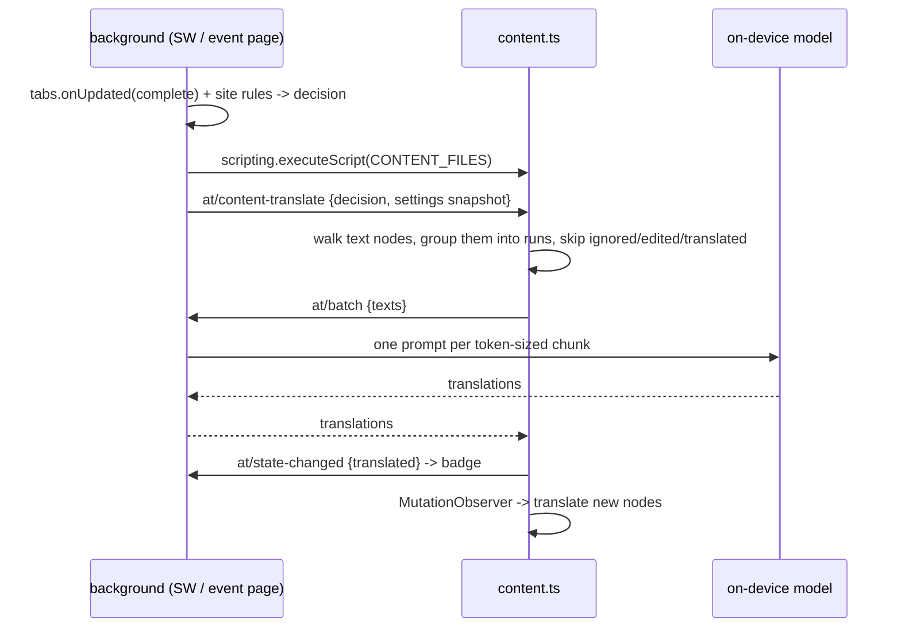

# Autotranslate

Automatic web-page translation for **Chrome** and **Firefox** from a single Manifest V3
source tree, written in **TypeScript**. One `src/` folder, one build script, two
browser-specific bundles — each shipped as a ready-to-upload zip.

Pages are translated in place: text nodes are replaced, originals are kept so the page can
be restored, and a `MutationObserver` keeps up with dynamically inserted content. Translation
is **on-device only**: a quantised TranslateGemma model, run by the background context, so no
page text ever leaves the browser and there is no endpoint, no API key and no account to set
up (see [On-device translation](#on-device-translation)).

## Correctness and validation

See [the validation contract](docs/testing.md) for automated coverage and its limits.
Page sessions now invalidate late results, compare source text before writing, and
track completion separately from restore records. Inline text uses validated
markers or a per-node fallback, never proportional word redistribution. Models
are staged, successfully loaded and selected before the previous active file is
retired. The browser regression gate must pass before the Release job publishes.

## Requirements

| Requirement | Minimum | Why |
| --- | --- | --- |
| Chrome | 121 | MV3 + the `background.scripts` fallback key must be ignored, not rejected |
| Firefox | 121 | MV3 `scripting` API and `background.scripts` alongside `service_worker` |
| Node | 24 | runs `tsc` and executes the `test/*.ts` suites directly (type stripping) |
| WebGPU-capable GPU | — | the current host requires an adapter; this check alone does not prove the selected inference backend |

## Quick start

```sh
npm install          # typescript, @types/node, webextension-polyfill, @mediapipe/tasks-genai
npm run build        # compile + validate -> build/chrome, build/firefox, dist/*.zip
```

The build compiles `src/` and `demo/` with `tsc`, validates the result, copies the
per-target assets, and packs each bundle:

```
build/chrome/                          load unpacked from here
build/firefox/                         load temporarily from here
dist/autotranslate-<version>-chrome.zip    upload as is
dist/autotranslate-<version>-firefox.zip   upload as is (AMO accepts .zip; rename to .xpi if you prefer)
```

**Chrome** — open `chrome://extensions`, enable *Developer mode*, *Load unpacked*,
pick `build/chrome`.

**Firefox** — open `about:debugging#/runtime/this-firefox`, *Load Temporary Add-on…*,
pick `build/firefox/manifest.json`. Unsigned add-ons can only be loaded temporarily;
`web-ext sign` (not bundled) is needed for a permanent install.

Either way the first thing that opens is the onboarding page (see [First run](#first-run)).


The shipped files are plain classic scripts: `tsc` compiles and type-checks, there is no
bundler, no polyfill beyond the vendored `webextension-polyfill`, and no runtime
dependency ends up in the package.

## First run

Translation is off and there is no model until the user finishes onboarding, which is the
only thing a fresh install shows:

| Step | What happens | Where |
| --- | --- | --- |
| 1 | Choose the language pages are translated into (defaults to the browser's UI language) | `welcome.html` |
| 2 | Install the model: **download** it (progress, cancel) or **pick a file** already on disk. Either route writes the file into OPFS, then asks the host to load it — a file that does not load is not "installed" | `welcome.html` → `AT.modelflow` |
| 3 | Press *Start translating*: `enabled: true`, the model id and the language are stored, and the page closes | `welcome.html` |

`runtime.onInstalled` (reason `install`) opens this page and stores `enabled: false`. If the
profile already holds a working model (a reinstall, a second browser), the page says so and
only asks for the language and the *Start* click.

**Side panel first.** `AT.ui.openPage` docks the page to the side of the window when the
browser has `chrome.sidePanel` (`side_panel.default_path` is `welcome.html`), and opens a tab
when it does not. Chrome only allows `sidePanel.open` in response to a user gesture, and an
install is not one, so the first run after installing still lands in a tab; the popup's
settings button *is* a gesture, so on a profile without a model it reopens onboarding in the
panel. Firefox has no side panel: it always gets the tab.

After that there is one control: the popup's switch. On translates every page into the target
language and applies at once to the tab in front of the user; off puts the page back and stops
translating new ones. A per-site rule (`never`/`always`, set in Options or from the page's
context menu) is the only exception. The popup also carries the target language; everything
else lives in Options, which stays an ordinary settings page rather than part of the flow.

## Scripts

| Command | Effect |
| --- | --- |
| `npm run build` | compile, validate `src/`, emit `build/{chrome,firefox}` and `dist/*.zip` |
| `npm run build:chrome` / `build:firefox` | one target only |
| `npm run watch` | rebuild on any change under `src/` |
| `npm run typecheck` | `tsc --noEmit` over the extension and over the tooling/tests |
| `npm run lint` | run the validator without writing output |
| `npm run verify` | audit `dist/*.zip`: CRC per entry, entry list against `build/<target>`, manifest flavour |
| `npm test` | compile, then `node --test test/*.test.ts` |
| `npm run ci` | typecheck, lint, test, build, verify — the exact steps CI runs |
| `npm run demo` | serve the sample page at `http://127.0.0.1:8732/demo/` |
| `npm run icons` | regenerate `src/icons/*.png` from `scripts/make-icons.ts` |

The build is also the linter: it fails on a manifest/package version mismatch, a
missing referenced file, a TypeScript error in `src/`, `demo/`, `scripts/` or `test/`, a
PNG that is not a PNG, a missing `_locales` key in either locale, or a `background.scripts`
list that no longer matches the `importScripts()` call in `background.ts`.

## Layout

```
src/                     TypeScript, compiled to classic scripts (no bundler)
  manifest.json          single source; the build rewrites it per target
  background.ts          menus, badge, tab state, message router, auto-translate
  content.ts             injected on demand: translate / restore / selection card
  welcome.{html,ts}      first run: language, model install, switch on
  popup.{html,ts}        the on/off switch and the target language
  options.{html,ts}      model store, limits, site rules, debug
  styles.css             shared by welcome, popup and options
  offscreen.html         the Chrome placement of the on-device host, opened by URL
  offscreen.ts           message plumbing for that document; the host itself is a lib
  lib/
    constants.ts         AT namespace, message names, languages
    browser.ts           the only file that names the host global; AT.api, capabilities, i18n, onMessage
    local.ts             prompts, token budgets, model records, host status, storage keys
    modelstore.ts        model bytes in OPFS + metadata in IndexedDB (seams for tests)
    modelflow.ts         one install path (download or file) + prepare, shared by welcome and options
    ui.ts                where an extension page is shown: side panel when the browser has one, else a tab
    gemma.ts             TranslateGemma's language table and the GemmaLang type (581 codes)
    pagecontext.ts       what kind of page this is, from its own metadata (collect / analyze / hint)
    targets.ts           which region a text is in, how visible it is, and what to translate first
    pipeline.ts          the page translation engine: page context + plan + batches + write-back
    localhost.ts         the host: one LlmInference, a serial queue, idle unload, placement-agnostic
    rules.ts             site pattern matching and precedence
    settings.ts          defaults, validation, persistence, content snapshot
    engines.ts           the model call: token packing, language codes, error codes
    dom.ts               text-node walker, run merging, replacement cache, restore
  _locales/{en,ko}/messages.json
  icons/                 generated PNGs (16/32/48/128)
demo/                    offline sample page that drives the same AT.dom engine
  index.html             sample document + request inspector
  demo.ts                translates, restores, and verifies the sample
  glossary.ts            offline phrase dictionary (a stub, not a model)
scripts/
  build.ts               compile + per-target manifest + vendor copy + validation + zip
  zip.ts                 dependency-free ZIP writer/reader
  package-spec.ts        targets, required entries per target, add-on id, archive name
  verify-package.ts      packaging gate: audits the archives in dist/
  make-icons.ts          dependency-free PNG encoder
  serve-demo.ts          static server for the sample page
test/                    node:test suites in TypeScript, one file per feature:
  rules, settings, constants     site rules, settings normalisation, the shared catalogue
  engines                        the model call: token packing, language codes, error codes
  dom, content                   walker, run merging, markers, restore, selection card, observer
  background, popup, options     message router and tab state, the two UI pages
  i18n, messages                 catalogue substitutions, data-i18n apply, send/receive envelope
  glossary                       the offline sample dictionary
  local, modelstore              prompts, chunking, records, status; transfers and cleanup
  build, zip, fresh-clone        validator, archive format, a build from a clean checkout
build/                   generated: build/ts (tsc output), build/{chrome,firefox}
dist/                    generated: one zip per target
```

Every source file compiles to a **classic script** that attaches to a single global `AT`
namespace (`tsconfig.json` sets `module: "none"`), because the two background contexts load
code differently and MV3 content scripts cannot be ES modules. Types live in the file that
owns the value, so `AT.settings.Settings` or `AT.dom.Translator` is the contract consumers
compile against. Load order is fixed:
`constants → browser → rules → local → settings → engines → dom`.

## How a page gets translated



Decisions live in the background (`decide()` in `background.ts`); the content script only
obeys the switch and per-site rules; source-language detection happens at the engine boundary.
Content scripts are never declared in the manifest — they are injected on demand, so
untouched pages pay nothing.

### Keeping the page intact

`AT.dom.createTranslator` writes **only `Text.nodeValue`**. It never creates, removes,
re-parents or re-attributes an element, so the CSS cascade, classes, inline styles, event
listeners and authored element attributes remain intact. Text length can still change layout and wrapping. Originals are
kept in a `Map<Text, {source, text, applied}>` in memory — never as DOM attributes — which
is what makes byte-exact `restore()` and "did the page rewrite this node since we touched
it" both possible.

Around that, three rules decide what leaves the page and where the answer lands:

- **Whitespace envelope.** Leading/trailing whitespace is split off before the request and
  re-attached afterwards, so a model that trims its answer cannot swallow the only space
  between two inline elements, and authored indentation survives.
- **Inline runs are merged.** Consecutive text nodes that a reader sees as one sentence —
  split by `<strong>`, `<a>`, `<em>` — are sent as **one** string with private-use markers
  (`\uE000{n}\uE001`) at the boundaries, so the model can re-order the sentence the way
  the target language needs. A run never crosses a block element or a `<br>`, and an
  ignored inline element (`<code>`, `pre`, …) ends the run so protected content is never silently omitted from its middle.
  Set `mergeInline: false` to send every text node separately.
- **Markers are verified, never guessed.** A merged answer is accepted only when every
  marker returns, in order, with content on both sides. Otherwise that run alone is retried
  **one text node per request** — a model that eats placeholders costs generations, it does
  not misfile text into the wrong element.

Ignored content is decided by `C.IGNORE_SELECTOR` plus `isIgnoredElement` (contenteditable
regions and their editable children), and `hasText` keeps whitespace, punctuation and symbol
only nodes out of the request entirely.

### Reading the page, not guessing it

A page publishes what it is, in three layers, and `lib/pagecontext.ts` reads all
three without leaving the page:

| Layer | Where | What it yields |
| --- | --- | --- |
| Structured data | `meta[property="og:*"]`, `meta[property="article:*"]`, schema.org `JSON-LD` (parsed, `@graph` included), microdata | page kind, site name, section, tags, **entities** (people, places, organisations, works, `DefinedTerm`s), the page's declared subject (`about` / `mentions`) |
| Semantic HTML | `nav`, landmarks, `dl`/`dt`/`dd`, `dfn[title]`, `abbr[title]` | the site's **sections** (its own navigation labels) and a **glossary** of terms the page defines |
| Accessibility | `html[lang]` and per-element `lang` | the page's language, and which regions are already in it |

`collect` is the only half that touches the DOM; `analyze` is pure and decides what the
values mean. The markup's claim outranks the URL — `og:type: product` is a product page
whatever the path says — and the vocabulary is deliberately conservative: a page that
claims `og:type: article` stays an *article* even when it has a category, because calling a
blog post "news" would put a wrong register in the prompt. A page whose metadata says
nothing useful ends up `unknown`.

Every axis is bounded, because all of it is attacker-controlled markup: 8 JSON-LD scripts of
120 KB, a 400-node graph walk at depth 6, 12 entities, 8 sections, 12 glossary terms, 200-char
texts. A JSON-LD script that does not parse is still scanned for `"@type"` names, so a
truncated payload still tells us what kind of page it is.

Where it goes: the content script collects once per translation pass and sends the result
with each `at/batch`; the background normalises it (nothing from a page is trusted) and the
on-device engine renders **one line** into its prompt, after the instruction and before the
two blank lines that precede the text:

```
Produce only the Korean translation, without any additional explanations or commentary. …
This is a news article in the Politics section from Example News. It mentions Alice Smith, The Coalition and Bob Jones.


The headline
```

Measured against real markup (the HTML five sites actually served, parsed the way a page is):

| Page | kind | site | sections | glossary |
| --- | --- | --- | --- | --- |
| ikea.com product (og `product.group`, 24 `Product` nodes in an `ItemList`) | `product` | IKEA | Products, Rooms, Deals, Design & ideas | 0 |
| meta.discourse.org topic (no JSON-LD, `generator: Discourse …`) | `forum` | Discourse Meta | Home, Categories, Guidelines | 0 |
| developer.mozilla.org reference | `docs` | MDN Web Docs | the page's own nav | 3 |
| en.wikipedia.org article (MediaWiki JSON-LD: `Article`, `Organization`) | `article` | en.wikipedia.org | footer links (the header has none) | 12 |
| github.com repository (`og:type: object`, nothing else) | `unknown` | GitHub | Actions, Documentation, Training | 0 |

The catalogue in the IKEA page and the publisher in the Wikipedia page are exactly the noise a
graph is full of, so entities are not "everything named": only `about`/`mentions` (the
declared subject), people, defined terms and events are kept. That table is also why the rules
look the way they do — `og:type: product.group` counts as a product, a platform generator can
be the only claim a forum makes, and `og:type: object` with no structured data earns nothing.

Only a recognised kind earns the first sentence, and only named entities earn the second;
an unidentified page with nothing named adds no line at all, because a bare host is true of
every page and would cost prompt tokens. The glossary is *not* in that line: it is collected
for consistency work (the same term translated the same way), not for describing the page.
Nothing is fetched to build any of this — the module only reads markup the page already
downloaded.

### The page translation engine

`lib/pipeline.ts` is where the modules meet. It owns one pass end to end:

```
pagecontext.collect/analyze  →  PageContext (site, section, subjects)
dom.collect                  →  the page's text nodes
targets.roleOf / priorityOf  →  per node: region and visibility
targets.plan                 →  ordered groups (visible first, one per region)
dom.translateNodes           →  batches, sentence-split, written back in place
```

The only thing it asks of the outside world is `translate({ texts, role, context })`, so the
same engine drives the browser (the callback posts `at/batch`) and the tests (the callback
returns strings). `translate()` is a fresh pass; `refresh()` is the scroll/mutation pass and
only pays for text that is not done yet; `restore()` puts the page back and drops the records.
`content.ts` is now a thin adapter: message handling, the observer and scroll timers, the
selection card — no planning and no DOM classification of its own.

### What gets translated, and in what order

The page is a document, not a bag of strings: a comment under an article, a menu label and a
table cell want different treatment, and a reader sees one screen of it at a time.
`lib/targets.ts` answers three questions mechanically (no model, no network):

| Question | Rule |
| --- | --- |
| Which region is this text in? | `comment` > `navigation` > `form` > `footer` > `aside` > `heading` > `article` > `list` > `metadata`, decided from tags (`article`, `main`, `nav`, `form`, `footer`, `aside`, `h1`–`h6`, `ul`/`li`, `time`), ARIA roles, `itemtype="…Comment"`, and the class/id markers sites actually use for comment threads |
| Is it on screen? | `getBoundingClientRect()` against the viewport: `visible`, then a one-screen ring (`near`), then `far` |
| In what order do we send it? | `visible` first, then `near`, then `far`; inside one priority, grouped by region (headings, article text, lists, metadata, comments, forms, navigation, asides, footer) and kept in document order inside a group |

A comment inside an article stays a comment, a list inside an article stays article text, and
a menu inside a footer stays navigation — precedence is the table above, not the first tag
found. The translator then runs one pass over that plan, so the screen is translated before
the rest of the document, and a scroll pass translates what came into view since (`state.done`
keeps it from paying twice).

**Pages that render late, and pages that never stop changing.** Three failures decided the
shape of a pass on real sites:

| Failure | What the script does now |
| --- | --- |
| Content arrives after the initial page load, including while inference is running | the observer starts before the first translation request and queues inserted or edited regions for a later pass |
| A page that mutates faster than the debounce (video progress, ads, live counters) pushed the pending tick back forever | a mutation inside the window keeps the scheduled tick and marks another one due, so the pass runs |
| A page that rewrote a translated node's text in place put the source back, and the node was then skipped because its answer was already cached | the cache answers the write as well as the request: the node is translated again without asking the model |
| Every mutation meant reading the whole body again — thousands of nodes, several times a second, on a feed | the observer reads its own records: an inserted subtree or an edited text node is the region the tick visits. Removals, ignored regions (`contenteditable`, `translate="no"`) and the script's own write-back are dropped before they can schedule anything, and a tick that is already running only leaves a note for the next one instead of starting a second pass |

A batch that fails no longer takes the rest of the page with it: the nodes stay eligible, the
remaining groups still translate, and the pass reports `failed` and the host's own message.
Only a pass where *every* group failed is an error, which is what the popup shows.

Grouping is also what lets a batch carry register: a batch of navigation labels, comments or
form labels gets one extra line in the on-device prompt (`These are navigation labels.`), on
top of the page context. Article prose gets no line — the page context already says what it is.
That line costs 6–10 tokens (measured), which is why it is per batch and not per text.

**Sentence splitting.** A multi-sentence text node is split into sentences before it is sent:
each sentence is its own key, the translations are joined back into the same node, and the
separator is the page's own habit — a space when the source used spaces, nothing between CJK
sentences. That is what keeps a long paragraph from being cut mid-clause, and it means one
paragraph can span several prompts without losing its place. `targets.sentences()` uses
`Intl.Segmenter` with a punctuation fallback; it is not abbreviation-aware (`Dr.` splits),
which is pinned in the tests rather than papered over.

**One request per text.** A paragraph's sentences travel in one request: the numbered prompt
holds them in order, so each sentence is translated with the others as its context — that is
the paragraph, and no separate hint line is sent. Requests are not batched across texts:
measured on the same four sentences, four singles took 3.4 s and one packed request 3.5 s,
because a generation costs ~40 ms per output token and only ~0.15 s per request. Packing also
costs progressive writes, so the engine keeps one request per text.

**What context is sent (decided).** One line per batch, composed in this order and capped at
`targets.CONTEXT_MAX_CHARS` = 240 characters (~40 tokens):

| Order | Content | Cost (measured) |
| --- | --- | --- |
| 1 | the page line: kind, section, site, and up to three named subjects | 5–12 tokens |
| 2 | the region line, only for regions where register matters (`comments`, `navigation`, `form`, `heading`, `list`, `metadata`, `aside`, `footer`) | 6–10 tokens |

Nothing else goes in. The collected glossary, site sections and entity list stay out of the
prompt on purpose: measured, a docs page's metadata block is 382 tokens — 75% of the input
budget at `localMaxTokens: 1024` — and would crowd out the text it is supposed to help. Above
the cap the line is cut on a word boundary, never grown. When the budget is raised later (a
setting, or 8192), the same function is the only place that needs to change.

## Cross-browser handling

Every context calls the extension API through the `browser` abstraction: `src/lib/browser.ts`
is the single file that names a host global (standard `browser` from the vendored polyfill
first, Chrome's `chrome` only as the fallback), and everything else uses `AT.api` or one of
its surfaces. Where the two browsers genuinely differ, the difference is a named question
rather than a guess about the user agent — `AT.supportsOffscreen()` is the only place that
decides whether the model can have a document of its own. `scripts/build.ts --check` fails a
source file that reaches past the abstraction, and `test/build.test.ts` checks the same rule
independently.

| Difference | Chrome | Firefox | How `src/` copes |
| --- | --- | --- | --- |
| Background context | `background.service_worker` | `background.scripts` (event page) | both keys in one manifest; MDN's sanctioned fallback pattern |
| Loading shared code | `importScripts()` in the worker | ordered `scripts` array | `background.ts` calls `importScripts` only when it exists; the build asserts the two lists match |
| Promise APIs | native | varies by API | vendored `webextension-polyfill` is loaded first in every context |
| Add-on identity | none | `browser_specific_settings.gecko.id` | injected by `scripts/build.ts` for `--target=firefox` |
| Chrome-only keys | `minimum_chrome_version` | would be dead weight | stripped for the Firefox bundle |
| On-device host | offscreen document (`chrome.offscreen`) | the background page itself | one host module, one caller (`AT.local.callHost`); the placement is chosen at runtime |
| Where a page is docked | `chrome.sidePanel` | no side panel | `AT.ui.openPage` tries the panel, falls back to a tab; `side_panel` and the permission are stripped for Firefox |
| Unsigned packages | fine | temporary load only | documented above; sign with `web-ext` when publishing |

## The engine

One engine: quantised **TranslateGemma 4B** through `@mediapipe/tasks-genai`, running in this
browser. There is no endpoint to validate, no key to keep and no request to send — the engine
layer (`AT.engines.translate`) turns a batch of texts into a prompt, asks the host, and writes
the answer back. Identical strings are sent once, whitespace- and number-free nodes are never
sent, an empty answer keeps the original text, and a failed generation surfaces in the popup
with a code (`config`, `provider`, `format`, `network`, `timeout`) instead of leaving a
half-translated page silently.

Chunks are packed by **tokens**, not characters: `AT.local.chunkByCounts` asks the host for a
per-text token count against the model's own tokenizer, and a text too long to ever fit
travels alone instead of being dropped. One chunk is one generation and is never retried — a
repeat would spend another minute on the same model for the same answer.

The model file is not shipped: it is the user's download (see below). `demo/glossary.ts`
implements the same `(texts: string[]) => Promise<string[]>` shape, which is why the sample
page can exercise the real DOM engine without a model.

## On-device translation

**The only engine.** A page is translated without opening a socket: the model runs in this
browser, and no page text leaves it. The model file itself is a one-time download in Options
(3.6 GiB, see below); until it is there the popup says so and nothing is translated, because
there is nowhere else to send the text.

| Piece | Where it lives |
| --- | --- |
| Runtime | `vendor/mediapipe/` — `@mediapipe/tasks-genai` copied out of the devDependency by `scripts/build.ts` into both bundles; which context executes it is decided at runtime |
| Model bytes | OPFS (`navigator.storage.getDirectory()`), one file per model; metadata in IndexedDB (`autotranslate-models`) |
| Inference | `lib/localhost.ts` — one `LlmInference`, one generation at a time, in whichever context can hold it |
| Prompt | `AT.local.buildTranslatePrompt` / `buildBatchPrompt` — the model's own translator preamble over `AT.gemma` codes; the Gemma turn markers are mandatory, without them the model answers with a bare newline |
| Languages | `AT.gemma.LANGS`, the 581 codes of the model's chat template; `GemmaLang` is `keyof typeof LANGS`, so a prompt can only be built from a spelling the model lists |
| Source language | the page's own text, detected with the browser's `i18n.detectLanguage` (CLD); an explicit `sourceLang` setting wins, and an undetectable text gets a prompt that asks for the target alone instead of inventing a source |

**Getting a model.** A 3.6 GiB file has no business inside an extension zip, so the user
supplies it once. Options offers the TranslateGemma 4B IT int8 card and streams it into
OPFS, or takes a file picked with the file input — the route for the gated Hugging Face
repository, which needs a token; the token is kept in the model store rather than the
settings blob, so it never travels with a settings snapshot. A model becomes visible only
after its whole stream is written and the byte count matches what the transfer promised: a
short write is deleted and reported (`truncated`, `too-small`), and the copy it replaces is
retired only after the new one successfully loads, warms up and becomes the persisted
selection. A failed download, warmup or settings write leaves the old file recoverable. Removing a model in Options deletes the bytes as well as the record, and the usage
line reports what the origin has used of its quota.

Options asks the browser to pin that storage before a transfer starts; if the browser
refuses, the usage line says the bytes may still be evicted, instead of letting the user
find out after a reboot.

**Where it runs.** The model needs WebAssembly plus WebGPU for longer than a service
worker lives, so `lib/localhost.ts` is a host module with two placements and one caller
interface:

| Browser | Placement | How the host is reached |
| --- | --- | --- |
| Chrome | `offscreen.html`, created with `chrome.offscreen` (reason `WORKERS`) | runtime messages: `at/local-load`, `at/local-unload`, `at/local-translate`, `at/local-status` |
| Firefox | the background page itself, which is already a document | direct calls — the module is part of the manifest's `background.scripts` |

Both branches sit behind `AT.local.callHost`, which answers with the same `{ok, …}` shape
either way, so the engine layer, the popup and the Options page never ask which browser
they are in. The placement is a runtime decision (`chrome.offscreen` present or not), not a
build flag: both bundles carry the same files.

One instance, one queue: generations are serialised, the model is warmed right after loading
so the first real sentence is not 8× slower, and it is released after ten minutes idle — a
resident 4B model costs gigabytes. `at/local-status` (or the reporter the background
installs) is what the popup line and the Options status read.

**Budgets.** The model is sized by the tokens one generation may spend, so texts are packed to
`localMaxTokens` (128–8192, default 1024) counting input *and* expected output, and a text too
long to fit even alone is refused explicitly with `context-overflow`, retaining the original text. Several texts go out as one numbered
prompt; if the reply cannot be split back reliably, that chunk is re-run one text per
generation.

**Keeping the file.** Options asks the browser to pin the storage before a transfer starts
(`AT.modelstore.requestPersistence`). When that is refused the usage line says so instead of
leaving the user to find out after a reboot has evicted 3.6 GiB.

**The prompt is the model's, not ours.** TranslateGemma was tuned on one shape: a
professional-translator preamble naming both languages, the instruction, two blank lines,
then the text — with the codes spelled as its chat template spells them. `AT.gemma` holds
that table (581 codes, copied from the template's language map), `GemmaLang` is its key
type, and the only translation of our UI codes into it is one alias: `zh-CN` → `zh-Hans`,
because the model has no `zh-CN`. A code it does not list never reaches a prompt: the
engine refuses the target (`config`) and simply omits an unknown source.

**Checked pairs.** The model was checked by hand for `en`, `ko`, `ja`, `zh-CN` (its
`zh-Hans`) and `zh-TW`; every other pair still translates, but the popup labels it *not
checked* rather than pretending it is equally good (`AT.local.isVerifiedPair`).

**Offline by construction.** There is no fallback to configure: `AT.engines` has one
implementation, and a failed generation is reported as a failure. Nothing in the extension
opens a network connection for translation.

**Historical performance measurements, before the correctness hardening below; not revalidated by CI.**

Measured on one Apple-silicon machine, Chromium, TranslateGemma 4B IT int8
(3,896,377,344 bytes), cold profile unless noted, with the prompt and language
codes of this revision:

| Step | Measured |
| --- | --- |
| Store the model (3.6 GiB → OPFS) | 5.2 s |
| Load the model + warm up | 6.3 s |
| Reload it in a warm profile | 3.8–5.4 s |
| One English → Korean sentence (warm) | 0.6–0.8 s |
| One Japanese → Korean sentence (warm) | 0.58 s |
| Two sentences as one generation, cold (load included) | 10.1 s |
| Three sentences as one generation | 1.5 s |
| Same three after a refused numbered reply (4 generations) | 2.5 s |
| French → Korean with `auto` source | 0.8 s |
| Offscreen document JS heap | 137 MB (the model lives in the WASM/GPU heap) |
| Four-sentence paragraph, one request for its sentences | 3.3–3.5 s |
| Same paragraph, one request per sentence | 5.5 s |
| Ten-paragraph page, two sentences each (11 nodes) | 15.0 s |
| Eight one-sentence nodes | 6.9 s |

**Where the time goes (measured, so it is not guessed at).** A generation costs about 40 ms per
output token, which is the whole of a page's time: a request's fixed cost — template prefill,
host round trip — is 0.1–0.2 s, so packing four texts into one request removes three of those
and nothing else. Three routes to a 2× were measured and none of them works here:

- **GPU delegate.** `@mediapipe/tasks-genai` 1.2.1-rc accepts `delegate: 'GPU'` and loads this
  (int8, `-int8-web`) model through it — load goes 5.4 s → 16 s — and then decodes at the same
  ~40 ms/token as the CPU build.
- **Two instances.** Two browser processes, each with its own copy of the model, decode a
  sentence in 1.6–2.2 s while one alone takes 0.95 s: the machine is bandwidth-bound, so a
  second model buys nothing and costs 3.6 GiB.
- **Bigger batches.** Four sentences as one generation: 3.5 s against 3.8 s for four singles.

So the ceiling is the model itself: halving a page needs a runtime that decodes the same
weights faster, or a smaller model. TranslateGemma ships only 4B, 12B and 27B, and the
LiteRT 270M/1B web builds are gated behind a Hugging Face access request (this account was
refused), so the honest answer is that this revision is 1.1–1.3× faster than the sentence-per-
request one it replaces — not 2×. The next real step is the same weights in a WebGPU runtime
(ONNX Runtime Web): the model would have to be converted to ONNX first, which is a project of
its own.

**What the budget is counted in.** Tokens, not characters — the model's own tokenizer counts
them. Before packing, the engine asks the host (`at/local-count`) for the token count of every
text and for the measured cost of the instruction; the host answers with
`LlmInference.sizeInTokens`. The chunker then packs by those numbers
(`chunkByCounts`), and the host re-measures the finished prompt before generating, halving
the batch if it still does not fit. Characters survive in two places only: the ceiling the DOM
layer uses to split a long page run, and the fallback estimate used when no host can answer.

The context budget, measured with the model's own tokenizer (`LlmInference.sizeInTokens`,
600-character samples of real prose, 1170-character chunks):

| Script | Characters per token | What the old `3 chars/token` did |
| --- | --- | --- |
| Latin | 6.12 | over-estimated 2×: half the budget unused |
| Cyrillic | 4.65 | over-estimated |
| Arabic | 2.75 | over-estimated |
| Japanese (kana + kanji) | 1.76 | **under-estimated 1.7×** |
| Korean (Hangul) | 1.82 | **under-estimated 1.6×** |

So `estimateTokens` now counts per script (6 Latin, 4.5 Cyrillic, 2.5 Arabic/Indic, 1.7 CJK) and
the chunker's instruction overhead is the measured 81–88 tokens (plus at most 12 for the
page-context line) instead of a guessed 240. Before the fix a 1170-character Korean chunk needed
639 input tokens + 85 overhead + its answer — 1363 against a `localMaxTokens` of 1024, i.e. it
did **not** fit. The estimator is still only a packing heuristic: the host measures the finished
prompt with `sizeInTokens` and halves the batch when it does not fit, so the tokenizer decides,
not the estimate. Measured after the fix, 2340 characters of prose at `localMaxTokens: 1024`:

| Input | Generations |
| --- | --- |
| English (6 × 390 chars) | 1 |
| Korean (6 × 390 chars) | 4 |
| Japanese (6 × 390 chars) | 4 |
| Korean (12 × 390 chars) | 8 |

The model's published window is 128K tokens, and MediaPipe's `maxTokens` is input *plus* output;
the extension caps it at 8192, of which the page context spends at most 12.

**Firefox caveats.** The `offscreen` permission is stripped from the Firefox manifest
(there is no such API), and the host runs in the event page, so a browser that idles the
page drops the model and the next translation reloads it. WebGPU is also younger there than
in Chrome: when `navigator.gpu` is missing or has no adapter the host answers `no-webgpu`
with the `config` code and both UI surfaces say the browser cannot run the model — before a
user spends 3.6 GiB on it, because the status probe runs when Options opens. There is no cloud fallback.

## Sample page

```sh
npm run demo         # http://127.0.0.1:8732/demo/
```

The sample is a styled page with a fake page's worst habits — a sentence split by
`<strong>`/`<em>`/`<a>`, `&nbsp;` in the hours, a `<code>` inline in a sentence, a `pre`
block, `kbd`, a table, an `address` with `<br>`, a `contenteditable` draft,
`.notranslate` and `[translate="no"]` markers. It loads `constants.js` and `dom.js` from the
compiled output and drives `AT.dom.createTranslator` exactly the way `content.ts` does, with
`demo/glossary.ts` — a phrase dictionary, **not** a translator — answering in place of the
model.

- **인라인 문장 병합** decides whether a sentence that `<strong>`/`<em>`/`<a>` split travels
  as one marked string (the model may re-order it) or as one string per fragment. The
  *모델 요청* panel shows exactly what the model is asked for, with run markers drawn as `⟦n⟧`.
- **모델 시뮬레이션 → 마커 유실** strips the markers from the answer, so every merged run
  is refused and its pieces are requested one at a time — which is the expensive path, not
  the wrong-text path.
- **스타일·원문 검증** compares the sample subtree against the pre-translation capture:
  element signature (tag, class, attributes), 23 computed style properties per element, the
  untranslated regions, and — after 원문으로 — the original values byte for byte.

What those three settings measure on this page (83 text nodes, 45 elements, Chromium, the
offline dictionary answering instead of the model):

| 설정 | 모델 호출 | 요청된 문자열 | 병합 런 | 변경된 텍스트 노드 |
| --- | --- | --- | --- | --- |
| 병합 켜짐 · 마커 보존 | 1 | 22 (marked runs included) | 4 | 31 |
| 병합 켜짐 · 마커 유실 | 2 | 22, then 15 retried pieces | 0 | 31 |
| 병합 꺼짐 | 1 | 33 | 0 | 31 |

In all three runs the element structure, the 23 computed styles and the 7 protected regions
(`pre`, `code`, `kbd`, `textarea`, `select`, `.notranslate`, `[translate="no"]`,
`contenteditable`) came back with **0** differences, and restore returned all 83 text nodes
byte for byte — the only thing that ever changed is a `Text` node's value.

Because the dictionary is offline and never rewrites word order, fragments it does not know
stay in English on purpose. Real translation quality is a property of
`src/lib/engines.ts`, not of the sample.

## Site rules

Patterns accept `example.com`, `*.example.com`, `example.com/news/*` and
`https://example.com/news/*`. They are canonicalised on save (case, leading `www.`,
leading `*.` folded away) and compared by specificity: explicit scheme > host labels >
path prefix length. A tie resolves to `never`, so `example.com → always` plus
`news.example.com → never` does the obvious thing.

## Limits

- Top frame only; iframe content is left alone.
- No Shadow DOM traversal, no `<canvas>`/image or subtitle translation.
- `pre`, `code`, `textarea`, `select`, `abbr`, `[translate="no"]`, `.notranslate` and
  `contenteditable` regions are never rewritten.
- Attributes (`placeholder`, `alt`, `title`, `aria-*`) are not translated: they are the
  page's own text, and replacing them is a different risk profile than replacing a text node.
- Per pass: at most `maxNodes` text nodes (default 600); remaining nodes schedule another pass independently of cache hits or request count. One generation is bounded by
  `localMaxTokens` instead of a character budget.
- Merged runs are only merged when the whole run is being translated in that pass; a
  partial (observer-driven) pass sends its nodes separately, which costs word order but
  keeps a half-observed sentence from being glued together.
- The on-device engine runs only on bytes the user supplied: 3.6 GiB for TranslateGemma 4B
  int8, held on disk until they delete it in Options. Nothing in the repository or the
  archives is a model.
- On-device generations are serial — one request at a time per browser, other tabs queue —
  and the model is released ten minutes after the last page needed it.

## CI and releases

`.github/workflows/ci.yml` runs on every push to `main` and on pull requests:
install, type-check, validator, tests, both builds, the packaging gate, then a
clean rebuild to prove the archives are byte-reproducible. Both zips are uploaded
as the `autotranslate-bundles` artifact, so a pull request can be loaded into a
browser without merging it. Those steps live in `.github/actions/build-extension`
so the release job runs exactly the same pipeline.

`.github/workflows/release.yml` publishes on every push to `main`:

1. runs the same pipeline as CI through the shared action, so a red commit never
   gets packaged;
2. writes `dist/SHA256SUMS.txt`;
3. creates the release `v<version>` (from `package.json`) the first time that
   version is pushed, and replaces its assets on every later push — the Chrome
   bundle, the unsigned Firefox bundle and the checksums.

Bumping the version in `package.json` is how you cut a new release; any other push
just refreshes the download so it always matches `main`. `git push` is the only
step. The notes carry the commit and the workflow run, and the archives say how to
load them: unpacked for Chrome, temporary add-on (or `web-ext` signing) for
Firefox.

Browser integration automation and its explicit real-model/Firefox limitations are documented in [docs/testing.md](docs/testing.md).
